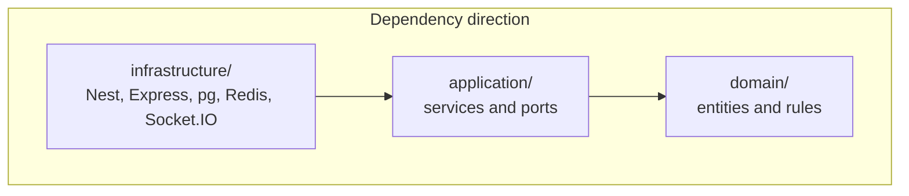
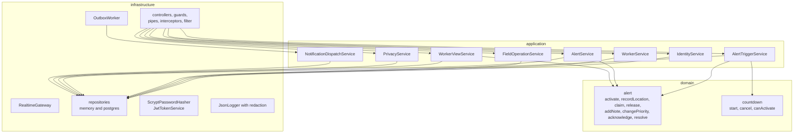
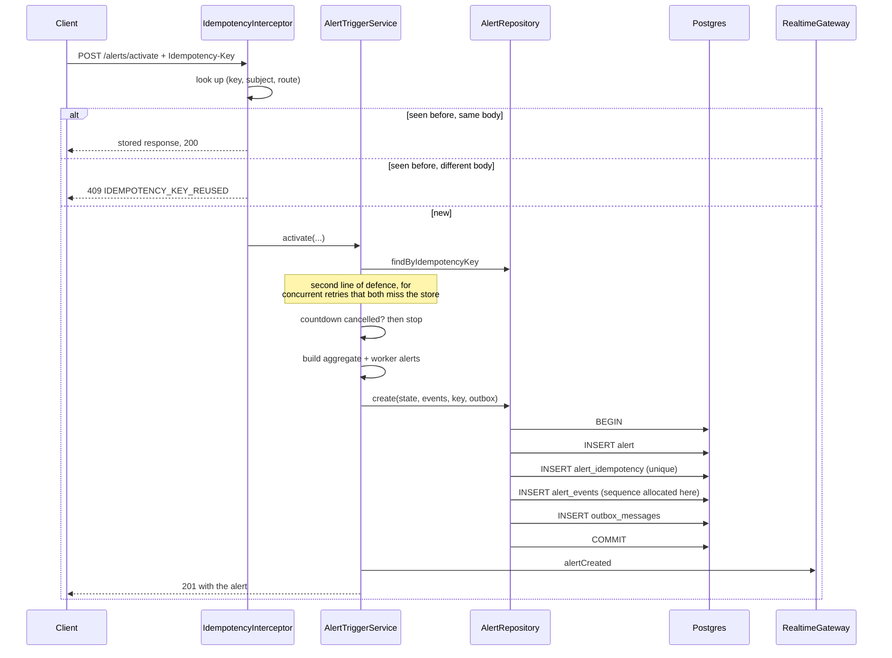
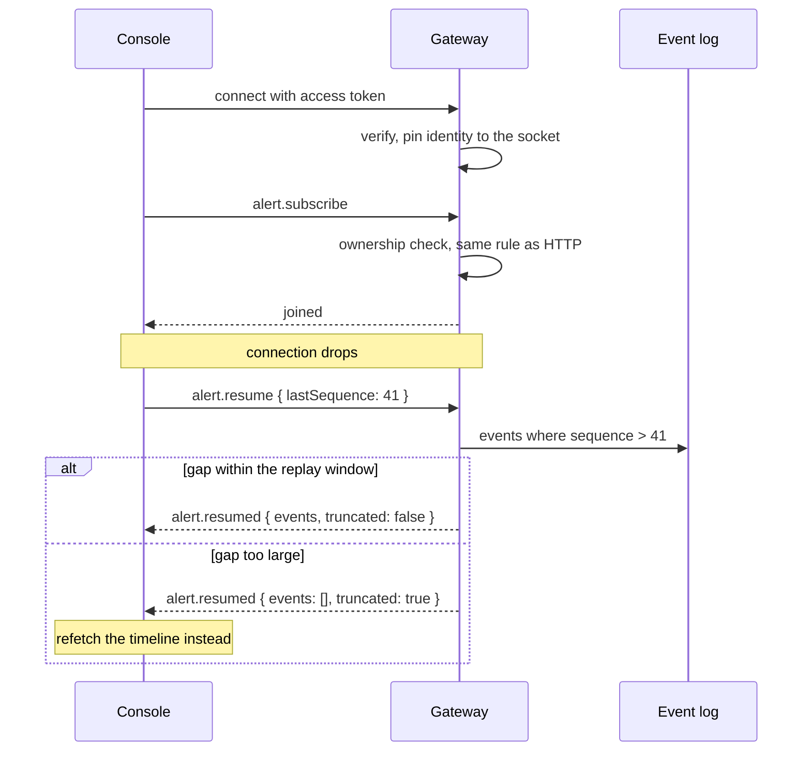

# Architecture

## Shape

One deployable backend, four clients, and a set of adapters chosen by configuration.

`domain/` imports nothing outside itself. `application/` imports `domain` and its own port
interfaces. `infrastructure/` imports both and is the only layer that knows a database exists.

That rule is what makes the rest of it work. The domain is pure functions over immutable state, so
`alert.spec.ts` runs 33 assertions in a few milliseconds with no fixtures. The application
services take ports through the constructor, so the whole test suite binds in-memory adapters and
needs nothing installed.

## Module map

## The write path that matters

Activation is the operation where being wrong is expensive in both directions, so it is worth
tracing in full.

Two things are load-bearing:

**The unique index on `(user_id, key)`.** Two retries arriving at the same instant both miss the
lookup. One wins the insert, the other gets a unique violation, reads back the winner's alert,
and returns the same identifier. A check-then-write without the constraint is a race.

**The single transaction.** The alert, its opening timeline events, and the outbox rows that
become worker notifications commit together. If the outbox insert fails there is no alert, and
that is the correct outcome: half an alert is worse than none, because the worker believes somebody
has been told.

## Real-time

Ordering is by a per-alert sequence allocated inside the writing transaction, never by a
timestamp. Device and server clocks disagree, mobile networks reorder, and a backlog flushed twenty
minutes late would otherwise render as if it happened twenty minutes late. Clients drop anything at
or below what they have already applied, which makes duplicate delivery harmless.

Authorisation happens per subscription, not only at connect. Without that, any logged-in user could
subscribe to a stranger's alert and watch their location move.

## Data

| Store | Holds | Why |
|-------|-------|-----|
| PostgreSQL | users, workers, sessions, countdowns, alerts, timeline, outbox, notifications, subscriptions, privacy, audit | Everything transactional and everything that has to be consistent |
| MongoDB | raw location pings, event snapshots | Append-only, write-heavy, never joined, expires on a TTL index. Nothing here is needed to reconstruct an alert |
| Redis | rate-limit counters, short-lived session state, distributed locks, manager presence | All of it disposable. Persistence is switched off locally on purpose |
| S3 | data exports | Large, sensitive, short-lived objects that do not belong in a database |

The timeline and the audit table both carry `DO INSTEAD NOTHING` rules for UPDATE and DELETE. An
audit trail a privileged caller can rewrite is not an audit trail, and enforcing it in the schema
means no future code path can quietly change that.

## Concurrency

Every mutable aggregate carries a `version`. Updates say `WHERE id = $1 AND version = $2`; zero rows
affected is a conflict, returned as 409 with the current version attached so the console can reload
and show what changed rather than making the manager guess.

Manager claims are leases, not locks. A five-minute expiry means a manager who closes their
laptop does not hold an alert forever, and re-claiming your own alert silently extends the
lease rather than emitting a duplicate timeline event.

## Configuration

Parsed once at startup through a Zod schema with cross-field rules. `PERSISTENCE=postgres` with no
`DATABASE_URL` refuses to boot rather than failing on the first query. Production refuses to run on
in-memory adapters. The three signing secrets must be distinct, because a shared secret would make a
worker-view link and an access token interchangeable except for a claim check.

## What I would change at ten times the scale

- Move the outbox relay out of the API process into its own task, so a slow provider cannot compete
  with request handling for the event loop
- Read replica for the manager console queue, which is read-heavy and tolerates slight staleness
- Partition `alert_events` by month; it is append-only and queried by recent range
- Move exports to a queued job with a signed, expiring download
- Redis-backed Socket.IO adapter so sockets survive more than one API task
