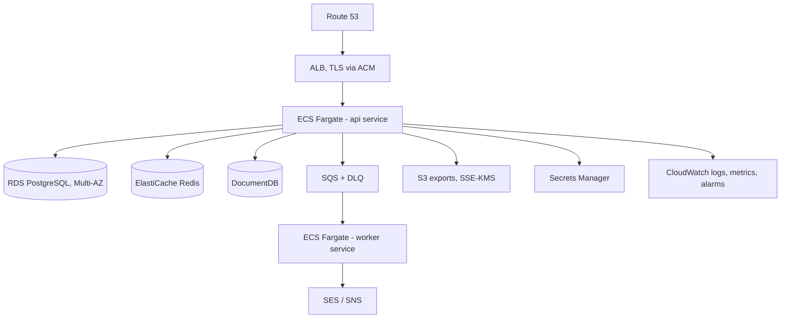
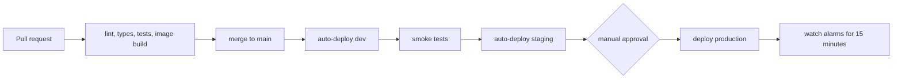

# Deployment

**Nothing has been deployed.** No AWS resource was created, nothing was pushed to a registry, and no
Terraform `plan` or `apply` was run against a real account. The brief requires explicit approval for
any of that and I do not have it. Everything below is the design and the runbooks, marked accordingly.

## Environments

| Environment | Purpose | State |
|-------------|---------|-------|
| local | Docker Compose, full stack, no cloud account | Working |
| dev | Single small ECS task, RDS t4g.micro | Terraform written, never applied |
| staging | Production shape at lower capacity | Terraform written, never applied |
| production | Multi-AZ, autoscaled | Terraform written, never applied |

## Target architecture

Fargate rather than EC2 because there is no cluster to patch. Fargate rather than EKS because nothing
here needs Kubernetes and the control-plane cost alone would exceed everything else.

## Cost awareness

Rough monthly figures for the dev environment, from public on-demand pricing at the time of writing.
These are estimates from a price list, not a bill, because nothing has been run.

| Resource | Configuration | Estimate |
|----------|---------------|----------|
| ECS Fargate | 1 task, 0.25 vCPU, 0.5 GB, always on | 9 USD |
| ALB | 1, low traffic | 18 USD |
| RDS PostgreSQL | db.t4g.micro, 20 GB, single AZ | 15 USD |
| ElastiCache | cache.t4g.micro | 12 USD |
| DocumentDB | db.t4g.medium, smallest available | 60 USD |
| NAT Gateway | 1 | 33 USD |
| SQS, S3, CloudWatch | low volume | 5 USD |
| **Total** | | **about 150 USD** |

Two lines dominate and both have cheaper answers. DocumentDB has no small instance class, so a dev
environment runs MongoDB in a container on the same task and only production uses DocumentDB. The NAT
Gateway costs more than the compute it serves, so dev uses VPC endpoints for S3 and SQS and no NAT at
all. Those two changes take dev to roughly 60 USD.

Everything is tagged `Project=guardianlink` and `Environment=<env>` so a cost report can attribute it,
and dev has a scheduled scale-to-zero outside working hours.

## Remote state

S3 bucket with versioning and SSE-KMS, DynamoDB table for locking, one state file per environment,
and separate IAM roles so a dev apply cannot touch production state. Bootstrap is a separate
Terraform configuration with local state, applied once, and it is the only place that ever runs with
elevated credentials.

## IAM

Least privilege, per service, no wildcards on resources. The task role can read exactly its own
secrets, publish to exactly its own queue, and write to exactly its own bucket prefix. The execution
role can pull the image and write logs and nothing else. GitHub Actions authenticates through OIDC
with a role scoped to the repository and branch, so no long-lived AWS key exists anywhere.

## Release flow

Migrations run as a one-off ECS task before the service update, and are additive-only, so the
previous version keeps working while both are live. That is what makes rollback possible: rolling
back code is safe because the schema still supports it.

## Rollback

1. `aws ecs update-service --task-definition <previous-revision> --force-new-deployment`
2. Watch the target group until healthy, usually two to three minutes
3. Do **not** roll the migration back. Additive migrations are forward-compatible; reversing one
   while traffic is being served is how data gets lost. If the schema genuinely has to change back,
   that is a new forward migration.
4. Record what happened in the incident log

## Backup and restore

| Data | Backup | Retention | Restore |
|------|--------|-----------|---------|
| RDS | Automated snapshots plus PITR | 7 days dev, 35 days production | Restore to a new instance, repoint, verify, cut over |
| DocumentDB | Automated snapshots | 7 days | New cluster from snapshot |
| S3 exports | Versioning plus lifecycle to Glacier at 30 days | 90 days | Restore the object version |
| Redis | None, deliberately | n/a | Rebuilt from Postgres on start |

Redis holds only rate-limit counters, short-lived state and locks. Backing it up would imply it holds
something that matters, which would be misleading.

**Restore drill, quarterly:** restore the latest snapshot to a scratch instance, run the migration
runner to confirm the schema matches, run a read-only smoke query, record how long it took, destroy
it. A backup nobody has restored is a hypothesis.

## Monitoring

| Alarm | Condition | Why |
|-------|-----------|-----|
| API 5xx rate | above 1 percent over 5 minutes | Something is broken |
| p99 latency | above 2 s over 5 minutes | Degrading before it breaks |
| Readiness failures | 2 consecutive on any task | A dependency is down |
| Outbox depth | above 100 for 5 minutes | Notifications are not going out. This one wakes someone |
| DLQ depth | above 0 | A notification was permanently lost |
| RDS connections | above 80 percent of max | Pool exhaustion approaching |
| RDS free storage | below 20 percent | Predictable and preventable |
| Incident activation errors | any 5xx on the activation route | The one path that must not fail |

Structured logs go to CloudWatch with the correlation id as a searchable field. Metric filters count
activations, deliveries and dead-letters, so the dashboard shows product behaviour and not only CPU.

## Disaster recovery

**RPO 5 minutes** through RDS point-in-time recovery. **RTO 2 hours** for a full rebuild.

Single region. Multi-region active-active would be a much larger piece of work and, for a portfolio,
would be claiming an operational capability that has never been exercised. The recovery procedure is
written down and has never been rehearsed, which is stated here rather than implied otherwise.

Recovery order: VPC and networking, secrets, RDS from snapshot, DocumentDB, ElastiCache, queues,
service. Each step has a check before the next begins.

## Verification status

| Item | State |
|------|-------|
| Terraform written | Yes |
| `terraform fmt` and `validate` | Configured in CI, not run on the build machine, which has no Terraform CLI |
| `terraform plan` against an account | Never run |
| `terraform apply` | Never run |
| Docker image build | Dockerfile written; build configured in CI |
| Any AWS resource created | None |
| Any deployment performed | None |
