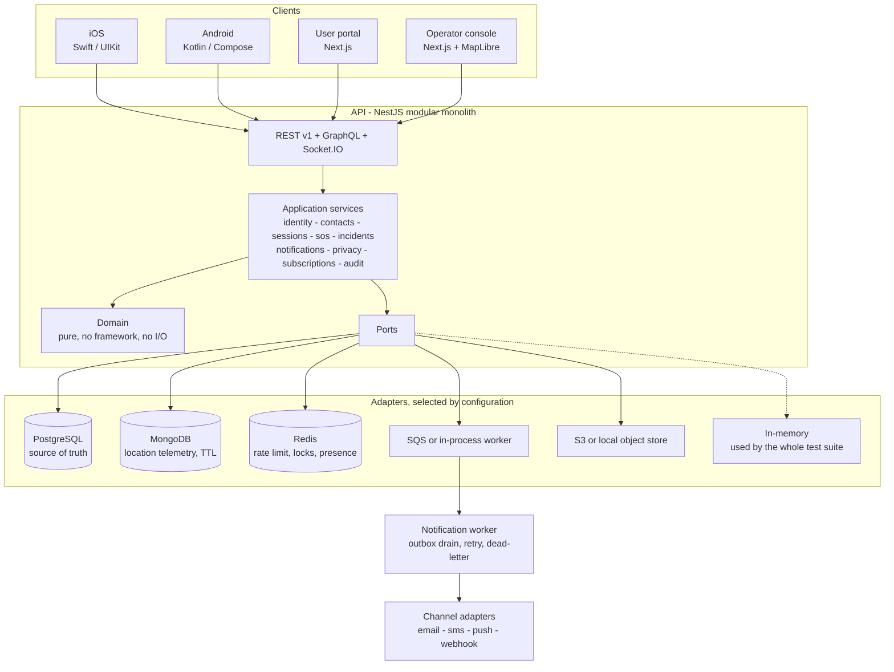
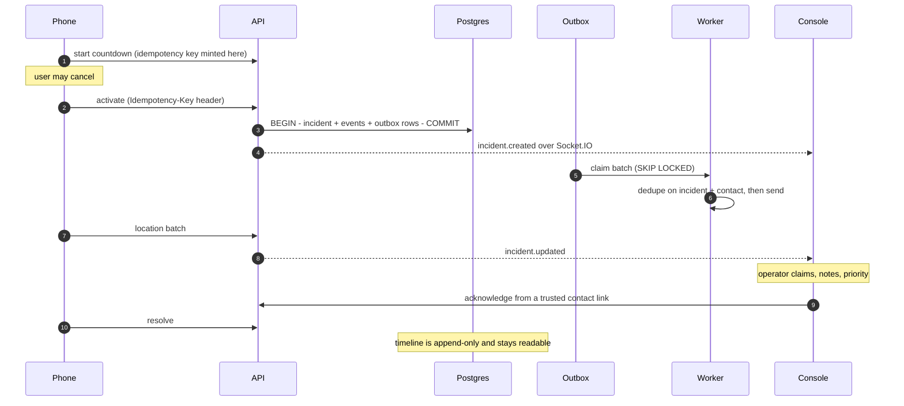

# GuardianLink

**A personal-safety and trusted-contact platform: iOS, Android, a TypeScript backend, and a web
operator console. Built as a portfolio piece.**

> GuardianLink is a demonstration. It is not a real safety service, it does not contact
> emergency services, and nobody is monitoring it. In a genuine emergency, call your local
> emergency number.

<!-- Badges point at the workflows in .github/workflows once the repository is on GitHub.
     They are left as plain links rather than shields for a repository that is not pushed yet. -->
[](.github/workflows/ci.yml)
[](docs/test-results/)
[](LICENSE)

---

## What it does

Someone walking home alone starts a safety session. If they feel unsafe they hold the SOS button,
which begins a short countdown they can cancel. If they do not cancel, an incident opens: their
trusted contacts are notified, their location streams to anyone authorised to see it, an operator
can pick the incident up and work it, and every step of it lands on a timeline that cannot be
edited afterwards.

## Why it exists

To answer one question honestly: can a single engineer own a multi-platform product end to end.
Not a demo of a login screen, and not four separate toy apps, but one system where a phone with no
signal, a retried request, two operators clicking the same button, and a person asking for their
data to be deleted all have a defined and tested answer.

## What it demonstrates

| Area | Specifically |
|------|--------------|
| Native iOS | Swift, UIKit, Core Data offline queue, Core Location, WidgetKit, App Intents, StoreKit 2 behind a protocol |
| Native Android | Kotlin, Compose, Room, coroutines and Flow, WorkManager background sync, Play Billing behind an interface |
| Backend | NestJS modular monolith, ports and adapters, versioned REST, GraphQL, Socket.IO, transactional outbox, idempotency, refresh-token rotation with reuse detection |
| Data | PostgreSQL as the source of truth, MongoDB for append-only telemetry with a TTL, Redis for rate limiting, locks and presence |
| Real-time | Per-incident monotonic sequencing, gap replay on reconnect, room-level authorisation |
| Infrastructure | Terraform for ECS Fargate, RDS, ElastiCache, SQS, S3, CloudWatch; Docker Compose for a full local stack with no cloud account |
| Quality | 340 automated tests that need no external services, WCAG contrast enforced by a failing test, PII redaction enforced by a failing test, and an OpenAPI document checked against the routes the router actually registers |

## Architecture



The dependency arrow only ever points inward: `domain` imports nothing, `application` imports
`domain` and port interfaces, `infrastructure` imports both. That is what lets the entire test
suite run against in-memory adapters, and it is why swapping SQS for an in-process worker is a
configuration change rather than a rewrite. Full detail in [ARCHITECTURE.md](ARCHITECTURE.md).

## The workflow this is built around



Every step above has tests, including the failure paths. See
[docs/WALKTHROUGH_TECHNICAL.md](docs/WALKTHROUGH_TECHNICAL.md).

## How to run it

Node 20 or newer, and pnpm. Nothing else.

```bash
pnpm install
pnpm build:packages
pnpm dev
```

The API comes up on `http://localhost:3001` and the web app on `http://localhost:3000`, both on
in-memory adapters. No database, no Redis, no AWS account, no API keys.

For the full stack with real Postgres, Redis, MongoDB, LocalStack and a mail inbox:

```bash
pnpm docker:up
pnpm seed          # demo accounts and five incident scenarios
```

Mail the demo "sends" is readable at `http://localhost:8025`. Demo credentials and the walkthrough
script are in [docs/DEMO.md](docs/DEMO.md).

## How to test it

```bash
pnpm verify        # format, lint, type-check and every test
```

Or individually:

```bash
pnpm --filter @guardianlink/api test        # unit + integration
pnpm --filter @guardianlink/api test:e2e    # the 13-step workflow over HTTP
pnpm --filter "./packages/**" -r test       # contracts, tokens, fixtures
```

None of these need a running service. That was a design goal, not a convenience: a test suite
which needs infrastructure is a test suite people stop running.

Recorded output from a real run is in [docs/test-results/](docs/test-results/).

## Screenshots and recordings

[docs/media/](docs/media/) describes what each asset shows and how to reproduce it. See the
[known limitations](#known-limitations) about which of these currently exist.

## Repository layout

```text
apps/
  api/         NestJS backend: domain, application, infrastructure, migrations, seed
  web/         Next.js user portal and operator console
  ios/         Swift / UIKit app, widget and App Intent
  android/     Kotlin / Compose app
packages/
  contracts/       Zod schemas: the single source of truth for the API surface
  shared-types/    Domain primitives, Result, branded ids, Clock
  design-tokens/   Tokens plus generators for CSS, Swift and Kotlin
  test-fixtures/   Deterministic synthetic data. No real people or places
infrastructure/
  docker/      Dockerfile and the local Compose stack
  terraform/   AWS: ECS Fargate, RDS, ElastiCache, SQS, S3, CloudWatch
docs/
```

## Main technical decisions

**A modular monolith, not microservices.** One deployable, hard internal boundaries. There is no
operational reason to split this, and splitting it would trade a real problem I do not have for
several I would.

**Ports and adapters everywhere.** Chosen for testability first. The payoff is that `pnpm test`
needs nothing installed and finishes in under a minute.

**Postgres is the source of truth; Mongo holds only telemetry.** Two databases need a real
justification or they are resume padding. Location pings are append-only, write-heavy, never
joined, and expire on a TTL, which is a genuine document-store fit. Nothing in Mongo is needed to
reconstruct an incident's state. Written up in [ADR-0004](docs/adr/0004-two-databases.md).

**scrypt rather than Argon2id.** Argon2 would be the first choice on a greenfield service, but
every maintained Node binding needs a native build, and this has to clone and run on a machine
with no toolchain. Parameters are stored with the hash and upgraded on login.
[ADR-0003](docs/adr/0003-password-hashing.md).

**Sequence numbers, not timestamps, for real-time ordering.** Device clocks are wrong and mobile
networks deliver out of order. A per-incident sequence allocated inside the writing transaction
makes ordering and gap recovery exact. [ADR-0005](docs/adr/0005-realtime-ordering.md).

**Idempotency is mandatory on activation.** A phone on a bad connection retries, sometimes after
the response was already delivered and lost. Five retries must not mean five alerts to somebody's
family. Enforced twice: at the HTTP layer and again at the database with a unique index.

## Trade-offs I made deliberately

- **Manual DI on Android instead of Hilt.** Keeps the object graph visible in a diff and the module
  buildable without codegen. On a real team I would use Hilt.
- **Exports are built synchronously.** Fine at this scale, wrong for an account with years of
  telemetry. The port is unchanged either way; only the caller moves to a queue.
- **A trusted-contact link is the credential.** No account, because asking someone to register at
  two in the morning makes the feature useless. Mitigated by scoping the token to one incident and
  one contact, and expiring it.
- **One tenant.** Multi-tenancy would add a key to every table and every authorisation check
  without showing anything the current authorisation work does not already show.

## Known limitations

Honest list. These are things that are missing or unfinished, not things I forgot to mention.

- **iOS is not compiled.** No macOS machine was available. The Swift sources, the widget, the
  App Intents and the XCTest suites are complete and reviewable, and the CI job exists, but
  nothing here claims the iOS app builds. Android is in the same position: the SDK is present
  but there is no Gradle distribution on the build machine.
- **Terraform is not validated locally.** The CLI was not installed on the build machine. CI runs
  `fmt` and `validate`; no `plan` has been run against a real account and nothing was deployed.
- **Contact verification is not implemented.** The `verified_at` column exists and the notification
  path already prefers verified addresses, but there is no flow that sets it.
- **GraphQL covers the operator read model and subscriptions only.** Mutations stay on REST
  because they need an Idempotency-Key header, a precise status code, Retry-After on 429 and a
  409 carrying the current version, all of which GraphQL flattens into a 200 with an errors
  array. Deliberate, and it does make the GraphQL surface smaller than the REST one.
- **Escalation is time-based, not adaptive.** A fixed window per step. Real products tune this per
  contact and per time of day.
- **No push notifications to real devices.** Mock providers only, by design. The APNs and FCM
  adapters are written against the same interface but have never been run.
- **Screenshots and recordings are described but not captured.** Producing them needs the app
  running on a device, which needs the toolchains listed above.

## Roadmap

1. Contact verification flow, so a notification cannot be sent to an unconfirmed address
2. Replace the synchronous export with a queued job and a signed, expiring download
3. Push adapters exercised against APNs and FCM sandboxes
4. Per-user retention sweeps rather than the single global floor
5. Breached-password check at registration
6. Multi-region read replica for the operator console

## Documentation

| Document | Contents |
|----------|----------|
| [ARCHITECTURE.md](ARCHITECTURE.md) | Layering, module boundaries, data flow, diagrams |
| [SECURITY.md](SECURITY.md) | Controls, reporting, what is deliberately not protected |
| [THREAT_MODEL.md](THREAT_MODEL.md) | Threats, mitigations, residual risk |
| [PRIVACY.md](PRIVACY.md) | What is collected, why, how long, who sees it, deletion and export |
| [TESTING.md](TESTING.md) | Strategy, what runs where, what is deliberately untested |
| [DEPLOYMENT.md](DEPLOYMENT.md) | Environments, rollout, rollback, backup, restore, disaster recovery |
| [CONTRIBUTING.md](CONTRIBUTING.md) | Workflow, commit conventions, review expectations |
| [CLAUDE.md](CLAUDE.md) / [AGENTS.md](AGENTS.md) | How AI agents are allowed to work in this repository |
| [docs/adr/](docs/adr/) | Architecture decision records |
| [docs/ai/](docs/ai/) | Spec-first AI workflow, security rules, review checklist |
| [docs/test-results/](docs/test-results/) | Real recorded output of the commands that were run |

## Suggested repository metadata

**Description:** Personal-safety platform demonstrating native iOS and Android, a NestJS backend
with real-time incident handling, and AWS infrastructure. Portfolio demonstration.

**Topics:** `typescript` `nestjs` `nextjs` `swift` `uikit` `kotlin` `jetpack-compose`
`postgresql` `mongodb` `redis` `socket-io` `terraform` `aws` `monorepo` `portfolio`

## Licence

[MIT](LICENSE).
