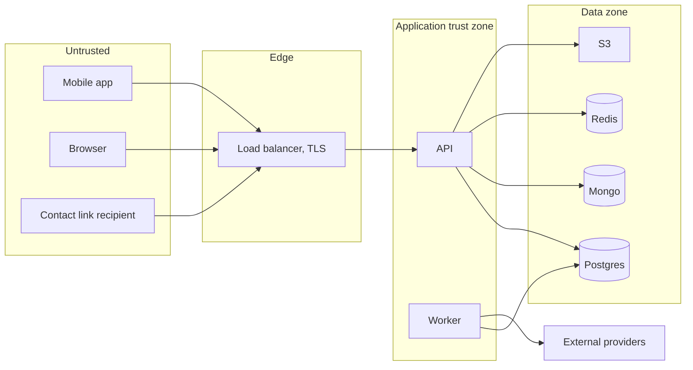

# Threat model

Scope: the GuardianLink platform as built. Method is loosely STRIDE, but organised by what an
attacker wants rather than by category, because that is how the mitigations actually cluster.

The thing worth protecting most is not the account. It is the answer to "where is this person right
now", and the list of people they trust.

## Assets

| Asset | Why it matters |
|-------|----------------|
| Live location during an incident | Discloses where someone is at the moment they are most vulnerable |
| Location history | Reveals home, work, routine, and who they visit |
| Trusted-contact list | A social graph of the people someone depends on |
| Incident timeline | Reveals that someone felt unsafe, and when |
| Credentials and tokens | Access to all of the above |
| Audit records | Accountability for privileged access |

## Trust boundaries

Everything from a client is untrusted, including a client the user owns. A rooted phone can send
any payload it likes, so no rule is enforced only on the device.

## Threats

### T1. Account takeover

**Vectors:** credential stuffing, password guessing, stolen refresh token, session fixation.

**Mitigations:** scrypt at OWASP parameters; rate limiting on login and registration; identical
responses and comparable timing for unknown-account and wrong-password, so the endpoint is not an
enumeration oracle; short access-token lifetime; opaque single-use refresh tokens stored as hashes;
family-wide revocation on reuse; every session revoked immediately when deletion is requested.

**Residual:** no MFA, no breached-password check, no lockout. A user with a weak, reused password
is not protected. Accepted and listed in SECURITY.md.

### T2. Broken authorisation, horizontal

**Vector:** an authenticated user reads or mutates another user's incident, contacts, sessions or
export by guessing an identifier.

**Mitigations:** ownership enforced in the service layer where the record is loaded, not only at the
route; list queries scoped to the subject at the repository level so no route can widen them by
accident; not-found rather than forbidden for another user's resource; socket subscriptions
authorised per room. Ten integration tests cover exactly this, one per operation, because a single
"authorisation works" test is how the gap on the eleventh endpoint survives.

**Residual:** low. This is the best-covered area of the codebase.

### T3. Broken authorisation, vertical

**Vector:** an ordinary user performs an operator action; an operator performs an admin action.

**Mitigations:** roles are a token claim set at issue, never accepted from a request body; operator
routes carry a role requirement and the service checks the role again; resolving as an operator
additionally requires holding a live claim.

**Residual:** a role change does not affect an already-issued access token until it expires. This is
inherent to stateless tokens, is bounded by the fifteen-minute lifetime, and is asserted by a test
so the behaviour is deliberate rather than accidental.

### T4. Location-data exposure

**Vector:** location reaches someone who should not see it, or is retained after it stops being
useful.

**Mitigations:** location accepted only from the subject and only while the incident is open;
visibility gated on two independent switches; contact links scoped to one incident and one contact
and time-boxed; coordinates redacted from every log sink; precise history off by default; TTL index
on telemetry; retention configurable within bounds, with a floor and a ceiling.

**Residual:** an operator on duty can see live location for any active incident, which is the job.
That access is audited. There is no cell-level or region-level restriction on which operator sees
which incident.

### T5. Replay and duplicate incidents

**Vector:** a retried or replayed activation creates several incidents, so a family gets five
alerts for one event.

**Mitigations:** mandatory idempotency key minted when the countdown starts, not when it fires, so a
crash mid-countdown still deduplicates; enforced at the HTTP layer and again by a unique index;
mismatched body under a reused key is a 409; outbox messages carry a dedupe key of incident plus
contact, checked by the consumer, which is what makes manual replay of a dead-lettered message safe.

**Residual:** a client that mints a fresh key for the same real-world event defeats this. Mitigated
by minting at countdown start rather than at send time.

### T6. Notification abuse

**Vector:** using the platform to send unwanted messages to a third party, or to flood a contact.

**Mitigations:** notifications only go to contacts the account owner added, and only when an
incident exists; rate limiting on contact creation and on the acknowledgement endpoint; free-tier
contact cap; delivery deduplicated per incident and contact.

**Residual:** contact addresses are unverified, so someone can add a number that is not theirs and
cause one message to it per incident. Verification is the top roadmap item. Documented rather than
glossed over.

### T7. WebSocket hijacking

**Vector:** subscribing to a stranger's incident stream, or continuing to receive events after
losing access.

**Mitigations:** token verified at handshake and identity pinned to the socket, never read from a
message payload; per-subscription ownership check; resume replays only events for an incident the
caller may see.

**Residual:** an access token valid at connect keeps the socket alive until it disconnects, even if
the token expires meanwhile. Bounded by connection lifetime. A periodic re-verify is the fix and is
not implemented.

### T8. Secret leakage

**Vectors:** a secret committed, printed in a log, returned in an error, or baked into a mobile
binary.

**Mitigations:** gitignore covers keys, certificates, keystores and profiles; gitleaks over full
history in CI; config schema rejects short and placeholder secrets and rejects reuse across token
types; logger redacts token and authorization keys; errors return a code, a safe message and a
correlation id, never internal detail; mobile apps hold no server secret.

**Residual:** CI secret scanning has not been executed on the build machine, only configured.

### T9. Insecure local storage on mobile

**Vector:** tokens or queued events readable from a lost or rooted device.

**Mitigations:** tokens in the iOS Keychain and the Android EncryptedSharedPreferences, never in
UserDefaults or plain preferences; the offline queue holds operation intents and coordinates, not
credentials; queued items are cleared on logout.

**Residual:** on a rooted or jailbroken device, nothing on the device is safe. No root detection is
implemented; it is trivially bypassed and gives a false sense of security.

### T10. Excessive retention

**Vector:** data kept because deleting it was never built.

**Mitigations:** TTL index on telemetry; retention settings with enforced floors and ceilings; a
retention sweep with a test; deletion that removes or anonymises everything the user contributed.

**Residual:** the sweep currently applies one global floor rather than per-user settings. Known and
on the roadmap.

### T11. Privilege escalation through deletion

**Vector:** an operator who accessed someone's location gets that account closed to erase the trail.

**Mitigations:** audit records have no cascade delete; the user row is anonymised rather than
removed so audit references resolve to a tombstone; audit tables reject UPDATE and DELETE at the
schema level; the deletion itself is audited. There is a test asserting the audit record survives
and contains no personal data.

### T12. Supply chain

**Vectors:** a malicious or compromised dependency; a compromised CI action.

**Mitigations:** small dependency surface, and zero third-party runtime dependencies on iOS;
lockfile committed; `--frozen-lockfile` in CI; Dependabot grouped weekly; `pnpm audit` at moderate
and above as a gate; CI permissions set to read.

**Residual:** actions are pinned by tag, not by digest. Pinning by digest is stricter and is not
done here.

### T13. Personal data in logs

**Vector:** a developer logs a whole object and coordinates end up in CloudWatch for a year.

**Mitigations:** redaction by key name at any depth, applied to both per-call context and child
bindings, so it cannot be bypassed by structuring the call differently; unit tests assert the
emitted line; identifiers are kept precisely so nobody needs to log values to debug.

**Residual:** redaction is by key name. A field called `userNote` containing an address would pass.
Mitigated by also redacting `note` and `body`, and by review.

## Out of scope

Physical device compromise; a malicious operator with legitimate access acting within their
permissions, beyond auditing it; nation-state adversaries; denial of service against infrastructure;
anything about real emergency services, which this system deliberately never contacts.
